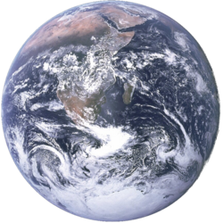

<strong>Hi, I'm Pooyan</strong>

<strong>Senior DevOps Engineer · Open Source Contributor</strong>

**Linux at heart. Automation by default.**

I build tools for infrastructure automation and contribute fixes to the open-source projects behind it.

Gothenburg, Sweden · Senior DevOps Engineer at Aptiv

Certified in AWS Solutions Architecture (Associate) and Terraform.

[LinkedIn](https://www.linkedin.com/in/pooyan-azad/) · [Medium](https://medium.com/@pooyan.azadparvar) · [GitHub](https://github.com/pooyanazad)

---

<strong>What I build</strong>

- **[AnsiblePower](https://github.com/pooyanazad/AnsiblePower)**: A lightweight web UI for Ansible playbooks.
- **[yamlguard](https://github.com/pooyanazad/yamlguard)**: YAML validation with optional security checks.
- **[kube-saver](https://github.com/pooyanazad/kube-saver)**: Kubernetes cost and resource insights.

<strong>Open source</strong>

I've contributed fixes and tests to projects including **Podman**, **Apptainer**, **NGINX Agent**, and **psutil**, with a focus on container tooling, infrastructure automation, and Linux systems.

**Languages**

  &nbsp;&nbsp;
  &nbsp;&nbsp;
  &nbsp;&nbsp;
  

Python · Go · C · Bash

**Infrastructure & automation**

  &nbsp;&nbsp;
  &nbsp;&nbsp;
  &nbsp;&nbsp;
  &nbsp;&nbsp;
  &nbsp;&nbsp;
  &nbsp;&nbsp;
  

Linux · Kubernetes · Docker · Ansible · Git · Terraform · AWS

---

Open to collaborating on Linux tooling, infrastructure automation, and cloud-native projects.

<strong>A little more about me</strong>

<table>
  <tr>
    <td>I'm a <strong>gamer at heart</strong>, especially when it comes to <strong>Dota 2</strong>.</td>
    <td width="84" align="center" valign="middle"></td>
  </tr>
  <tr>
    <td>I love <strong>travelling</strong> and discovering new places.</td>
    <td width="84" align="center" valign="middle"></td>
  </tr>
  <tr>
    <td>I unwind with a good <strong>movie or series</strong>.</td>
    <td width="84" align="center" valign="middle"></td>
  </tr>
  <tr>
    <td>I have a soft spot for <strong>arcade games</strong> and “one more try”.</td>
    <td width="84" align="center" valign="middle"></td>
  </tr>
</table>
